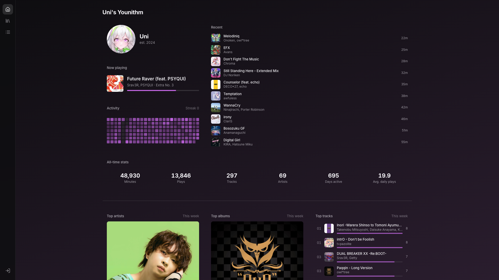

# Younithm

A smarter stats page, for the power listener.

Powered by a ListenBrainz-compatible API so you can scrobble wherever, whenever.

## What makes Younithm special?
Unlike other scrobblers, Younithm leverages direct connections to streaming services like Spotify and Apple Music, as well as databases like MusicBrainz, to smartly de-duplicate releases and provide the most accurate stats possible.

When you scrobble a track, it uses additional metadata like catalog IDs and ISRCs to match tracks and albums across streaming platforms, regardless of language or metadata differences. It combines this with advanced heuristics to match your library between platforms seamlessly, so no matter where you listen, your stats stay squeaky-clean.

Where other frontends think "Unfold" and "Unfold (feat. TEED)" are two completely unrelated tracks, Younithm can see "気まぐれメルシィ" and "Kimagure Mercy (feat. Hatsune Miku)" and know with confidence that they're one and the same.

And, if it does get it wrong, Younithm makes it real easy to fix, too.

Bring your history with you from Spotify and Apple Music, or from other scrobblers like Koito, Maloja, ListenBrainz, or last.fm (experimental).

## Requirements
Prerequisites:
- Docker Compose
- A ListenBrainz-compatible scrobbler (I recommend [Multi-Scrobbler](https://docs.multi-scrobbler.app/))

Optionally:
- An email address (for MusicBrainz API integration)
- Spotify Premium (for Spotify API integration)
- An Apple Developer account (for Apple Music API integration)

*While these things aren't strictly required, they're at the very least recommended, as Younithm relies on these connections to be able to do its smart matching.*

To get started, rename `docker-compose.example.yml` to `docker-compose.yml`, and then run `docker compose up -d`.

Then visit the web UI (default at `http://localhost:2015`) to get set up, and with a quick snap of the fingers, that's all there is to it!

## Additional Options
If you want Younithm to run under a path instead of the root domain (e.g. `example.com/example`), add `YOUNITHM_BASE_PATH: /example` to your environment variables.

If you'd like to use the free iTunes Search API as a fallback (in lieu of the Apple Music API) (VERY EXPERIMENTAL, basically untested), then set `YOUNITHM_ENABLE_ITUNES: true` in your environment variables.

## AI Disclosure
This project was developed with significant help from Claude. I've tested it all myself, and much of the research was mine (I have an autistic fascination with streaming services, for some reason), but much of the code was done by AI agents. 

## License
Younithm is licensed under the [GNU Affero General Public License v3.0](LICENSE).